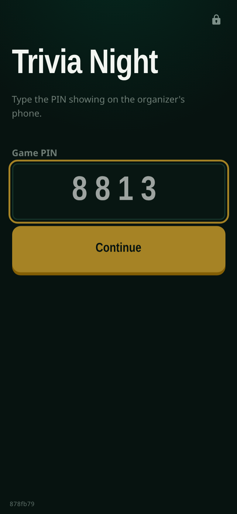
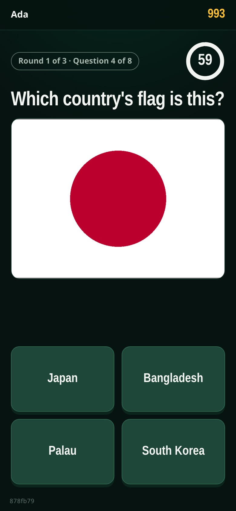
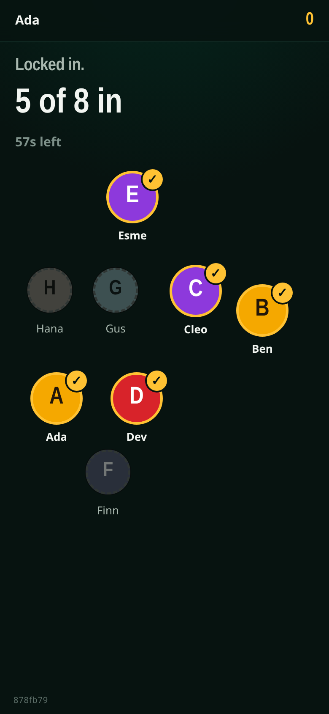
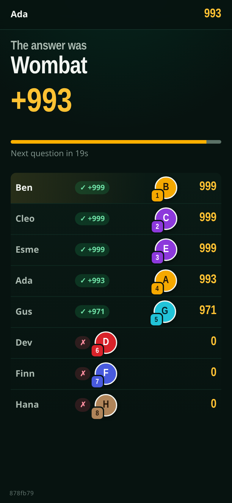
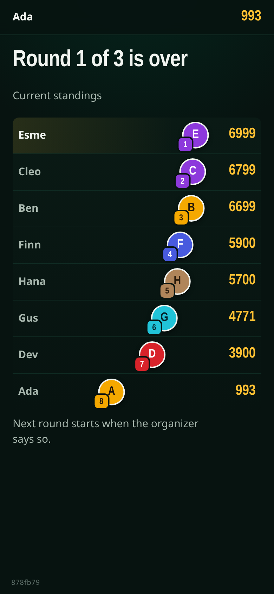
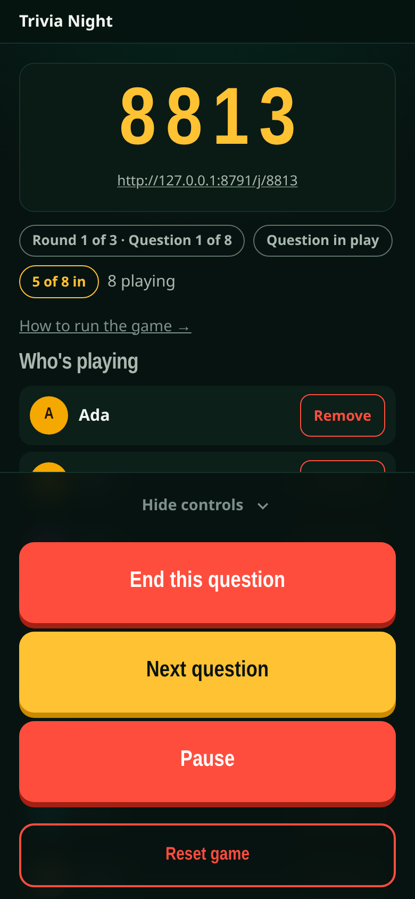

# Trivia

A trivia game for a room full of people, played on their own phones.

- **Everyone joins with a 4-digit PIN** (or a link you send to the group chat). No app to install, no accounts.
- **One question at a time, for everyone.** Each phone gets its own countdown, so someone on slow signal isn't punished for it.
- **No score moves until everyone has answered.** Then the answer is revealed and the whole room scores at once.
- **Five question types:** multiple choice (with optional pictures), true/false, a number dial for "how many…?" guesses, typed answers (forgiving of typos), and "who in this room is most likely to…?".
- **Optional selfies** turn players into faces on the leaderboard. Photos stay on your computer, are only shown to people in the same game, and delete themselves 24 hours after the game.
- **You run it from your own phone**: start the game, skip a question if someone's phone dies, and overrule "close enough" typed answers.

It runs with Docker, a free tool that runs ready-made software packages ("containers") with one command. You don't need to know how to program.

## Screenshots

All players and questions below are made up (the sample pack in `app/seed/questions.json`).

<table>
  <tr>
    <td></td>
    <td></td>
    <td></td>
  </tr>
  <tr>
    <td align="center">Join with the PIN</td>
    <td align="center">A question</td>
    <td align="center">Waiting for the room</td>
  </tr>
  <tr>
    <td></td>
    <td></td>
    <td></td>
  </tr>
  <tr>
    <td align="center">The reveal</td>
    <td align="center">Leaderboard</td>
    <td align="center">Organizer's phone</td>
  </tr>
</table>

---

## What you need

1. **A computer** to run the game on during the night: a laptop, desktop, home server or Raspberry Pi. Windows, Mac and Linux all work.
2. **Docker**
   - Windows or Mac: install [Docker Desktop](https://www.docker.com/products/docker-desktop/) and start it.
   - Linux: follow [the official install guide](https://docs.docker.com/engine/install/).
   - To check it works, open a terminal (on Windows, "PowerShell") and type `docker compose version`. You should see a version number.
3. **Players' phones must be able to reach that computer.** The easy case is everyone on the same Wi-Fi. For a bar or anywhere else, see [Playing away from home](#playing-away-from-home).
4. **This folder** on your computer. Download it as a ZIP from the project page and unzip it, or run `git clone <project address>`.

---

## Setup (about 5 minutes)

### Step 1: Set the organizer password

1. In this folder, make a copy of `.env.example` and name the copy `.env`. The name starts with a dot. On a Mac or Linux, files that start with a dot can be hidden: press Cmd+Shift+. in Finder to show them, or run `cp .env.example .env` in a terminal.
2. Open `.env` in any text editor (Notepad, TextEdit, etc.) and set `BARGAMES_ADMIN_PASSWORD=` to a password you make up. This is what you'll type on your phone to run the game.
3. Save the file. Leave everything else as it is for now.

### Step 2: Start it

Open a terminal **in this folder** and run:

```
docker compose up -d
```

The first run downloads and builds everything, which takes a few minutes. `-d` means it keeps running in the background.

### Step 3: Check it works

1. Run `docker compose ps`. You should see `trivia` saying `Up` and, after a few seconds, `(healthy)`.
2. Open **http://localhost:8000** on this computer. You should see the "enter the PIN" page.

### Step 4: Find the address for phones

Phones can't use `localhost`; they need this computer's address on your network. It usually starts with `192.168.` or `10.`:

- **Windows:** run `ipconfig` and look for "IPv4 Address".
- **Mac:** System Settings → Wi-Fi → Details → IP address.
- **Linux:** run `hostname -I` (the first number).

Then, on a phone on the same Wi-Fi, open `http://<that address>:8000`, e.g. `http://192.168.1.20:8000`. You should see the same PIN page. If not, see [Troubleshooting](#troubleshooting).

---

## Running a game

1. On your phone, open `http://<address>:8000/admin` and type your organizer password.
2. Check the settings (seconds per question, questions per round, how long answers stay on screen) and tap **New game**. A 4-digit PIN appears.
3. Players open `http://<address>:8000` and type the PIN, or tap the link under the PIN (send it to the group chat; it has the PIN built in). They type a name and can take a selfie.
4. Tap **Start the game** once everyone's in. Questions then run by themselves. Between rounds, tap **Next round**.

The full one-page guide for whoever holds the organizer's phone is built into the app at `http://<address>:8000/guide` (the same text as [`docs/RUNBOOK.md`](docs/RUNBOOK.md)).

---

## Writing your own questions

The questions are in `app/seed/questions.json`. Open it in a text editor, replace the sample questions with yours, save, then run `docker compose restart`. Every 8 questions make a round (you can change that on the organizer page).

Each question is one line. Copy one of each kind and change the words:

```json
{"id": "q1", "type": "multiple_choice", "prompt": "Which planet is closest to the Sun?", "options": ["Mercury", "Venus", "Mars", "Earth"], "correct": "Mercury"},
{"id": "q2", "type": "true_false", "prompt": "Sharks are mammals.", "correct": false},
{"id": "q3", "type": "number_wheel", "prompt": "How many legs does a spider have?", "correct": 8, "span": 6, "min": 0, "max": 20},
{"id": "q4", "type": "free_text", "prompt": "What colour do you get mixing blue and yellow?", "correct": ["green"]},
{"id": "q5", "type": "pick_player", "prompt": "Who is most likely to forget their own birthday?"}
```

- **`id`** must be different for every question (any short text).
- **`multiple_choice`**: `correct` must match one of the `options` exactly. Up to four options.
- **`true_false`**: `correct` is `true` or `false` (no quotes).
- **`number_wheel`**: players spin a dial between `min` and `max`. Exact answers score full points; `span` is how far off a guess can be before it scores nothing.
- **`free_text`**: `correct` is a list of accepted answers, in lowercase. Small typos still score; borderline ones show up on your phone under "Close calls" so you can overrule them.
- **`pick_player`**: no correct answer. Players score for agreeing with the rest of the room.
- **Pictures:** put an image file in `app/static/questions/` and add `"image": "your-file.png"` to a `multiple_choice` question.
- Every question except the last needs a comma after its closing `}`. If the app won't start after an edit, a missing or extra comma is the usual cause. Paste the file into any online "JSON validator" to find it.

**Title and colours:** edit `app/seed/branding.json`: `title` is shown on every screen, `badge` is an optional little label, and `theme` is `default`, `dusk` or `noon`.

---

## Who can reach it

- The **organizer page** (`/admin`) needs your password. After 5 wrong tries, that device is locked out for a minute.
- The **game** is open to anyone who can reach the address and knows the PIN. That's the point: guests shouldn't have to log in.
- **Selfies** are only shown to people in the same game, are never stored in a public folder, have location data removed, and are deleted 24 hours after the game ends. The organizer page also has a **Delete every photo now** button.

On home Wi-Fi only people on your network can reach it. Don't use "port forwarding" on your router to put it on the internet over plain `http://`; use one of the options below, which give you `https://`.

---

## Playing away from home

At a bar, guests are on mobile data and can't reach your home network. You need an internet address with `https://` that leads to the game. Two simple ways:

**A. Cloudflare quick tunnel** (free, no account, address changes each time). Install [cloudflared](https://developers.cloudflare.com/cloudflare-one/connections/connect-networks/downloads/), then, with the game running:

```
cloudflared tunnel --url http://localhost:8000
```

It prints an address like `https://some-random-words.trycloudflare.com`. That's the game's address for the night. Keep the terminal open while you play.

**B. Tailscale Funnel**, if you already use [Tailscale](https://tailscale.com/kb/1223/funnel): `tailscale funnel 8000`.

With either, set these in `.env` and run `docker compose up -d` again:

```
BARGAMES_COOKIE_SECURE=1
BARGAMES_TRUST_PROXY=1
TRIVIA_BIND=127.0.0.1
```

The first makes login cookies HTTPS-only, the second lets the lockout tell callers apart through the tunnel, and the third stops the game being reachable on your local network directly (the tunnel still reaches it).

If you serve it from your own server under a sub-path (e.g. `https://example.com/trivia/`) with a reverse proxy that strips the prefix, also set `BARGAMES_COOKIE_PATH=/trivia`.

---

## Updating to a new version

```
git pull
docker compose up -d --build
```

Your questions in `app/seed/` are your files, so if `git pull` complains about them, copy them somewhere safe first.

---

## Stopping and deleting

- Stop: `docker compose down`. Start again: `docker compose up -d`. A game in progress survives a restart.
- Delete everything, including any photos and saved game: `docker compose down -v`. This can't be undone.

---

## Troubleshooting

| Problem | Fix |
|---|---|
| `docker compose ps` shows `Restarting` | Run `docker compose logs --tail=30`. "BARGAMES_ADMIN_PASSWORD is not set" means Step 1 was missed. A JSON error means a typo in `questions.json` (usually a comma). |
| Phones can't open the address | Check they're on the same Wi-Fi (not guest Wi-Fi, not mobile data). Allow port 8000 through this computer's firewall: on Windows, accept the prompt when Docker asks; on Linux with ufw, `sudo ufw allow 8000/tcp`. |
| Phones open the page but joining fails, or photos don't show | If you're using an `http://` address, `BARGAMES_COOKIE_SECURE` must be `0`. |
| A phone is stuck on an old screen | Pull down to refresh. Nothing is lost. |
| Organizer page says "too many attempts" | Wait a minute and try again. |

---

## For developers

FastAPI + Jinja2 templates + plain JavaScript, no build step. The whole game lives in memory in **one** process (do not add workers) and is snapshotted to disk on every change. Design notes: [`docs/HOW-IT-WORKS.md`](docs/HOW-IT-WORKS.md); element ids the JavaScript relies on: [`docs/UI-CONTRACT.md`](docs/UI-CONTRACT.md).

Run locally without Docker (Python 3.12):

```
python -m venv .venv && .venv/bin/pip install -r requirements.txt pytest httpx
BARGAMES_ADMIN_PASSWORD=dev BARGAMES_SELFIE_DIR=./data BARGAMES_STATE_FILE=./data/game-state.json \
  .venv/bin/uvicorn main:app --app-dir app --port 8000
.venv/bin/pytest tests --ignore=tests/e2e        # fast tests
```

Browser tests (Playwright, up to thirty simulated phones): `.venv/bin/pip install playwright pytest-playwright && .venv/bin/playwright install chromium && tests/e2e/run.sh`.

---

## License

MIT. See [LICENSE](LICENSE).
